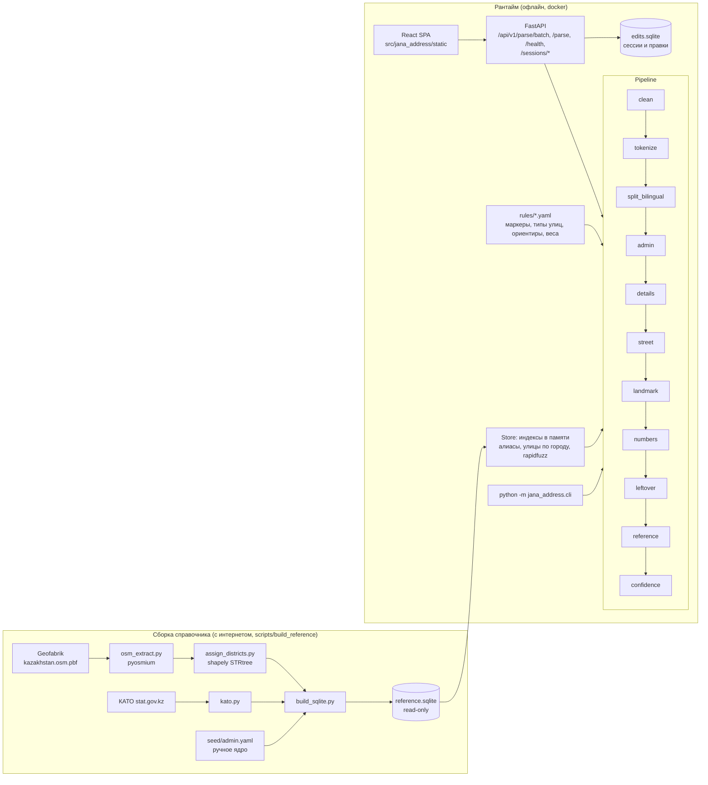

# Архитектура Jana Address

## Схема

## Пайплайн

Каждый шаг это объект с `name` и `__call__(ParseState) -> ParseState`. Шаги общаются только через `ParseState` (`pipeline/base.py`):

* `raw` — исходная строка, не меняется никогда; `text` — очищенная копия; `offsets[i]` — индекс в `raw` для `text[i]`;
* `tokens` — токены с позициями в `text` и меткой `used_by` (какое поле или маркер их забрал);
* `fields` — значения полей с источником (`string` | `reference:<seed|osm|kato>` | `manual`), спаном в `raw` и весом уверенности;
* `flags` — конфликты и сомнения для confidence; `trace` — что сделал каждый шаг (идёт в `?explain=true` и в UI).

| # | Шаг | Что делает |
|---|-----|-----------|
| 1 | `clean` | удаляет U+200B/C/D, U+2060, U+FEFF, U+00AD, управляющие символы; NBSP и прочие пробелы делает обычными; NFC; схлопывает пробелы; убирает пробел перед точкой. Строит карту смещений. |
| 2 | `tokenize` | `num` (`12`, `1/2`, `12а`, `12-а`, `12 А`), `word` (в т.ч. `пр-т`, `ж/м`), `sep` (`,;`), `punct`. Слитное написание разделяется регуляркой: `66квартал` → `66` + `квартал`. |
| 3 | `split_bilingual` | склейки `рус/каз` по токенам: казахская половина (буквы әғқңөұүһі, маркеры қаласы/облысы/...) помечается `kz_dup`. Дробь дома внутри числа сюда не попадает. Шаг стоит после tokenize: так `55/6` уже защищён как один номер. |
| 4 | `admin` | область (маркер + словарь, ВКО/ЗКО/СКО), город (`г.`, `город`, `қаласы`, посёлок/село, город без маркера в начале сегмента), район (`район`, `р-н`, `ауданы`, кроме «шағын ауданы»). Дубли схлопываются. |
| 5 | `details` | дом, кв., подъезд, этаж по маркерам `rules/markers.yaml`. Сначала слитные связки (`11дом`, `кв70`), потом общая ориентация строки (маркер до или после числа). |
| 6 | `street` | тип улицы (`rules/street_types.yaml`) до или после названия; площадные типы (мкр, квартал, ЖК) забирают номер в название; правило «мкр без улицы → street_type» и «мкр + улица → living_area»; улица без маркера = группа слов перед номером. |
| 7 | `landmark` | предлоги (напротив, возле...), объекты (магазин, ТЦ, школа...), бренды (Qazpost, Magnum...). Номер входит только после нумеруемых объектов (школа 25). |
| 8 | `numbers` | дом и квартира по позиции: первое свободное число после улицы; `150-23` → дом + кв.; индексы и телефоны пропускаются. |
| 9 | `leftover` | населённый пункт без маркера отдельным сегментом перед улицей (`Илийский район, Боралдай, ул. ...`). |
| 10 | `reference` | заполняет только пустые поля: город → область, район → город, мкр → район/город, улица(+дом) → район/тип/город. Строковое значение не перезаписывается никогда (`ParseState.set_field`). |
| 11 | `confidence` | взвешенная сумма из `rules/confidence.yaml`: доля разобранных токенов, остаток, флаги конфликтов, бонусы за совпадение со справочником. |

Значения `street_name` и `landmark` вырезаются из **оригинальной** строки по спану (`util.value_from`). Удаляются только невидимые символы и мусорная пунктуация по краям.

## Справочник в рантайме

`reference/store.py` открывает `reference.sqlite` в режиме `ro&immutable` и держит в памяти:
сущности (области, районы, города, микрорайоны, улицы), индекс алиасов `fold(alias) → [(тип, id)]`,
улицы по городу и районы улиц с весами. Дома запрашиваются из SQLite по индексу `(street_id, key)`.
Сопоставление: точное по алиасу → нормализованное (`normalize.fold`: регистр, ё/е, казахские буквы, ъ/ь, дефисы; транслит латиницы) → rapidfuzz `ratio` с порогом внутри найденного города.

## Почему так

* **Правила + справочник, без ML в рантайме:** работает офлайн, детерминированно, объяснимо (trace), 1000 записей разбираются меньше чем за секунду.
* **null лучше неверного:** метрика штрафует только неверное извлечение того, что есть в строке. Сомнительные эвристики (угаданная улица, угаданный город) ставят флаг и понижают confidence.
* **Словари в YAML:** команда добавляет маркеры, типы улиц и ориентиры без правки кода (`scripts/analyze_train.py --unknown` подсказывает, что добавить).
* **Запрет запоминания:** нет кэша по целой строке, в справочнике только топонимы; это проверяет `tests/test_no_memorization.py`.

## Хранилища

| Файл | Что | Режим |
|------|-----|-------|
| `reference/reference.sqlite` | справочник топонимов | read-only, кладётся в образ |
| `var/edits.sqlite` (`/app/var` в docker) | сессии UI, результаты, ручные правки | read-write, volume |
| `src/jana_address/rules/*.yaml` | словари правил | в образе |
