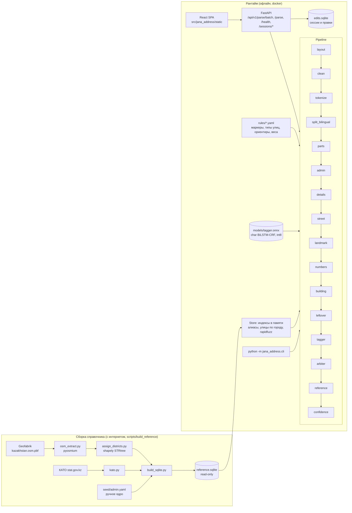

# Архитектура Jana Address

## Схема



## Пайплайн

Каждый шаг это объект с `name` и `__call__(ParseState) -> ParseState`. Шаги общаются только через `ParseState` (`pipeline/base.py`):

* `raw` — исходная строка, не меняется никогда; `text` — очищенная копия; `offsets[i]` — индекс в `raw` для `text[i]`;
* `tokens` — токены с позициями в `text` и меткой `used_by` (какое поле или маркер их забрал);
* `fields` — значения полей с источником (`string` | `reference:<seed|osm|kato>` | `manual`), спаном в `raw` и весом уверенности;
* `flags` — конфликты и сомнения для confidence; `trace` — что сделал каждый шаг (идёт в `?explain=true` и в UI).

| # | Шаг | Что делает |
|---|-----|-----------|
| 0 | `layout` | строка в английской раскладке вместо русской (нет кириллицы, после перекодировки QWERTY -> ЙЦУКЕН узнаются слова): перекодируется посимвольно, длина та же (Q19). |
| 1 | `clean` | удаляет U+200B/C/D, U+2060, U+FEFF, U+00AD, управляющие символы; NBSP и прочие пробелы делает обычными; NFC; схлопывает пробелы; убирает пробел перед точкой. Строит карту смещений. |
| 2 | `tokenize` | `num` (`12`, `1/2`, `12а`, `12-а`, `12 А`, `135 Л`), `word` (в т.ч. `пр-т`, `ж/м`, порядковые `1-я`, `2-й`), `sep` (`,;|`, а также ` / `, если строка использует его как разделитель: тогда дробь только слитная), `punct`. Слитное написание разделяется регуляркой: `66квартал` → `66` + `квартал`, `47Бдом` → `47Б` + `дом`. Служебные числа (телефон, почтовый индекс, время «до 18:00») сразу помечаются `noise:*` и дальше не достаются ни маркерам, ни полям. |
| 3 | `split_bilingual` | склейки `рус/каз` по токенам: казахская половина (буквы әғқңөұүһі, маркеры қаласы/облысы/...) помечается `kz_dup`. Дробь дома внутри числа сюда не попадает. Шаг стоит после tokenize: так `55/6` уже защищён как один номер. |
| 3a | `parts` | то, что не поле ответа: организация после ТОО/ИП/АО/ЖШС (название в кавычках или до трёх слов) -> noise; корпус/строение/блок/литер с номером («корп 2», «11к2», «стр. 1») забирается целиком: номер не станет квартирой, «корп» не попадёт в улицу. |
| 4 | `admin` | область (маркер + словарь, ВКО/ЗКО/СКО), город (`г.`, `город`, `қаласы`, посёлок/село, город без маркера в начале сегмента), район (`район`, `р-н`, `ауданы`, кроме «шағын ауданы»). Дубли схлопываются. |
| 5 | `details` | дом, кв., подъезд, этаж по маркерам `rules/markers.yaml`. Сначала слитные связки (`11дом`, `кв70`), потом общая ориентация строки (маркер до или после числа). |
| 6 | `street` | тип улицы (`rules/street_types.yaml`) до или после названия; площадные типы (мкр, квартал, ЖК) забирают номер в название; правило «мкр без улицы → street_type» и «мкр + улица → living_area»; улица без маркера = группа слов перед номером. |
| 7 | `landmark` | предлоги (напротив, возле...), объекты (магазин, ТЦ, школа...), бренды (Qazpost, Magnum...). Номер входит только после нумеруемых объектов (школа 25). |
| 8 | `numbers` | дом и квартира по позиции: первое свободное число после улицы; `150-23` → дом + кв.; индексы и телефоны пропускаются. |
| 8a | `building` | корпус/строение, забранный `parts`, входит в house как написано, если идёт сразу за номером дома («5 корп 2», «11к2», «30/1 стр. 2»); дома нет: house = корпус (Q10). |
| 9 | `leftover` | населённый пункт без маркера отдельным сегментом перед улицей (`Илийский район, Боралдай, ул. ...`). |
| 9a | `tagger` | посимвольная разметка raw моделью (раздел «Гибридный разбор»); батч жюри размечается заранее одним вызовом. Нет модели или она упала: шаг пустой, дальше только правила. |
| 9b | `arbiter` | сверка полей правил с разметкой модели, решение по спорным полям совместно, проверка справочником и грамматикой. В режиме `shadow` только пишет решения в trace. |
| 10 | `reference` | заполняет только пустые поля: город → область, район → город, мкр → район/город, дом → район и мкр, улица → доминирующий район/мкр (лучший кандидат и при неоднозначности, флаг), доминирующий тип, пункт → район области, ориентир → район (слабо). Строковое значение не перезаписывается никогда (`ParseState.set_field`). |
| 11 | `confidence` | вероятность, что все поля метрики верны: логистическая регрессия по признакам (доля разобранных токенов, наличие полей, остаток, худший score поля, флаги, подтверждение справочником), веса в `rules/confidence.yaml` подбирает `training/fit_confidence.py`. В trace вклады в вероятность (сумма = итог). |

Значения `street_name` и `landmark` вырезаются из **оригинальной** строки по спану (`util.value_from`). Удаляются только невидимые символы и мусорная пунктуация по краям.

## Гибридный разбор: правила + посимвольный теггер

**Зачем.** Правила сильны там, где есть маркеры и справочник, и слабы в комбинаторике контекста: населённый пункт
без маркера в конце строки или перед улицей («Бесагаш Айтеке би, 68»), строка без запятых, мусор перед улицей,
номерные улицы («2-й проезд Рахимова»), тип после названия («Коммунальный пер»). Посимвольная модель видит
контекст целиком, но не знает справочника и может уверенно ошибиться. Поэтому решение принимает арбитр: оба
кандидата проверяются справочником и грамматикой, побеждает лучше подтверждённый.

**Модель.** Char BiLSTM-CRF (`training/model.py`): эмбеддинг символа (нижний регистр, цифры -> «0») + регистр +
класс символа (кириллица / казахские буквы / латиница / цифра / пробел / пунктуация / невидимый) -> 2 слоя
BiLSTM (hidden 128) -> CRF по 27 BIO-тегам (13 классов: PROVINCE, CITY, DISTRICT, LIVING_AREA, STREET_TYPE,
STREET_NAME, HOUSE, APARTMENT, ENTRANCE, FLOOR, LANDMARK, KZ_DUP, NOISE; маркеры «кв», «дом» и пунктуация это O).
Около 600 тыс. параметров. Модель видит исходную строку raw до clean, поэтому её спаны сразу в координатах ответа.

**Данные обучения.** Только синтетика из собственного справочника (`scripts/gen_train_tagger.py`, 150 тыс. строк):
генератор dev-наборов с посимвольными спанами (`scripts/synth/`) + сильные искажения (`scripts/synth/augment.py`):
латиница и опечатки маркеров (`kv`, `flat`, `dom`, `pod`, `etazh`), склейки, регистр, невидимые символы,
двуязычные слэши, строки без запятых, город в конце, «Казахстан»/«Kazakhstan», телефоны, ФИО, служебные хвосты,
«17 А дом», номерные улицы, тип в конце, организации («ТОО «…»», «ИП …»: NOISE), корпус/строение сразу после номера как часть HOUSE (после «дом» O),
офис/бутик/павильон/кабинет (APARTMENT), прежние области после передела 2022 года. Около 15% улиц и 10% населённых пунктов (по хешу id) в обучение не
попадают никогда: на них считается метрика `unseen`, это проверка обобщения, а не запоминания. Строк train.json
в обучении нет; когда данные выдадут, `training/silver.py` добавит серебряную разметку из уверенных разборов
правил, подтверждённых справочником.

**Рантайм.** Эмиссии BiLSTM экспортированы в ONNX и квантованы в int8 (`models/tagger.onnx`, около 650 КБ),
Витерби и маргиналы CRF считаются на numpy (`tagger/crf.py`), torch в образе нет. Строки сортируются по длине,
батчи до 256 строк с паддингом; модель грузится и прогревается при старте. `JANA_TAGGER=off|shadow|on`
(`only` только для оценки модели отдельно). Нет файла модели, нет onnxruntime или модель упала: лог и работа на
правилах, батч не падает никогда.

**Арбитраж** (`pipeline/arbiter.py`, веса в `rules/arbiter.yaml`):

1. По каждому полю до двух кандидатов: правила (значение, спан, score шага) и модель (спан, откалиброванная на val
   вероятность). Значение модели строится так же, как у правил: строковые поля срезом raw по спану, canonical-поля
   (province, city, district) модель только локализует, вид ответа даёт справочник; нет в справочнике: кандидата нет.
2. Спаны совпали: значение правил (флаг `model_agree_all`, если так по всем полям: confidence выше).
3. Разошлись: счёт кандидата = априорное доверие к источнику + вес × вероятность + проверки: топоним существует и
   согласован с остальными полями, улица есть в этом городе, дом есть на этой улице, мкр в этом городе; этаж <= 40,
   подъезд <= 20, квартира правдоподобна, номер дома по образцу; спан не задевает мусор (NOISE). Невозможное
   значение (этаж 99, «ул» вместо названия) у модели не берётся никогда.
4. Спорные поля решаются совместно: перебор комбинаций с запретом пересечения спанов (символ raw не принадлежит
   двум полям). Так «Бесагаш Айтеке би» превращается в город «Бесагаш» + улицу «Айтеке би», только если улица
   действительно есть в этом селе; из одноимённых сёл выбирается то, где она есть.
5. Поле, где правила дали null, берётся у модели только с высоким счётом и вероятностью: null лучше неверного.
6. Решение и причины по каждому полю пишутся в trace и в `explain.model`.

Веса подобраны логистической регрессией (`training/fit_arbiter.py`) только на dev-наборах (dev_synth, dev_chaos,
val-синтетика теггера). Confidence подбирается отдельно и целиком (`training/fit_confidence.py`): форма на синтетике
dev (dev_synth, dev_chaos, val), уровень калибровкой Платта на живых dev-строках (llm_dev, egov_dev).

**Как переобучить.**

```bash
python -m venv .venv-train && .venv-train/Scripts/python -m pip install -r requirements-train.txt
python scripts/gen_train_tagger.py --n 150000 --seed 1001 --split train --out data/tagger/train.jsonl
python scripts/gen_train_tagger.py --n 5000 --seed 2001 --split train --out data/tagger/val.jsonl
python scripts/gen_train_tagger.py --n 3000 --seed 3001 --split unseen --out data/tagger/unseen.jsonl
.venv-train/Scripts/python -m training.train --train data/tagger/train.jsonl --val data/tagger/val.jsonl     --unseen data/tagger/unseen.jsonl --out training/runs/v2 --resume      # CPU, около 7 мин на эпоху
.venv-train/Scripts/python -m training.export --run training/runs/v2 --val data/tagger/val.jsonl     --unseen data/tagger/unseen.jsonl --out models                         # ONNX int8 + meta + калибровка
.venv/Scripts/python -m training.fit_arbiter --write                       # веса арбитра на dev
.venv/Scripts/python -m training.fit_confidence --write                    # веса confidence на dev (после арбитра)
.venv/Scripts/python scripts/compare_modes.py --out docs/hybrid_results.md # rules / tagger / hybrid + решение
```

Обучение по умолчанию на CPU: на ноутбучной RTX 2050 под WDDM CUDA падает на выделениях в сотни МБ. Рядом с
обучением не стоит запускать тяжёлое (тесты, экспорт): при нехватке памяти потоки torch падают с access violation;
`--resume` продолжает с последней эпохи.

## Справочник в рантайме

Геометрии в рантайме нет: всё пространственное (точка в полигоне, длины сегментов по районам, ближайшая
точка мкр) считает `scripts/build_reference/assign_districts.py`, в `reference.sqlite` лежат готовые
привязки (docs/REFERENCE.md). `reference/store.py` открывает файл в режиме `ro&immutable` и держит в памяти
только сущности (области, районы, города, микрорайоны, улицы), индекс алиасов `fold(alias) → [(тип, id)]` и
улицы по городу (текущие названия отдельно от старых: по старому имени ищем, только если по текущему пусто).
Лениво по индексам SQLite: дома `(street_id, key)` с районом, мкр и способом привязки мкр, доли улицы по
районам и мкр, доминирующий тип, объекты-ориентиры `poi_aliases(key)`, метод привязки пункта к району.
Старт ≈ 0.6 с. Источник восстановленного поля: `reference:osm:<house|street|polygon|point|poi>`,
`reference:seed`, `reference:kato` (`store.ref_source`).
Сопоставление: точное по алиасу → нормализованное (`normalize.fold`: регистр, ё/е, казахские буквы, ъ/ь, дефисы; транслит латиницы) → rapidfuzz `ratio` с порогом внутри найденного города.

## Почему так

* **Правила + справочник + маленькая модель, без LLM и сети:** работает офлайн, детерминированно, объяснимо (trace и решения арбитра по каждому полю), 1000 записей разбираются за секунды. Модель (650 КБ) только предлагает спаны; значение всегда срез исходной строки или каноническая форма справочника.
* **null лучше неверного:** метрика штрафует только неверное извлечение того, что есть в строке. Сомнительные эвристики (угаданная улица, угаданный город) ставят флаг и понижают confidence.
* **Словари в YAML:** команда добавляет маркеры, типы улиц и ориентиры без правки кода (`scripts/analyze_train.py --unknown` подсказывает, что добавить).
* **Запрет запоминания:** нет кэша по целой строке, в справочнике только топонимы; это проверяет `tests/test_no_memorization.py`.

## Хранилища

| Файл | Что | Режим |
|------|-----|-------|
| `reference/reference.sqlite` | справочник топонимов | read-only, кладётся в образ |
| `models/tagger.onnx`, `models/tagger_meta.json` | теггер: веса int8, словарь символов, переходы CRF, калибровка, метрики | read-only, кладётся в образ |
| `var/edits.sqlite` (`/app/var` в docker) | сессии UI, результаты, ручные правки | read-write, volume |
| `src/jana_address/rules/*.yaml` | словари правил | в образе |
